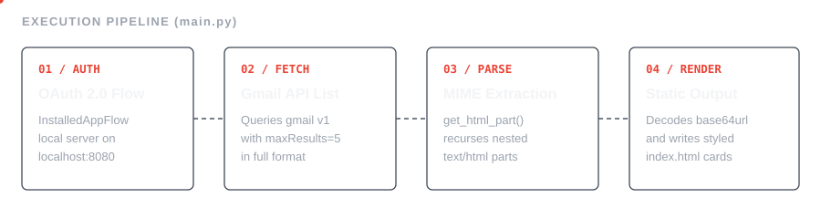

<p align="center">
  
</p>

<p align="center">
  <a href="#overview">Overview</a> &middot;
  <a href="#pipeline">Pipeline</a> &middot;
  <a href="#features">Features</a> &middot;
  <a href="#usage">Usage</a> &middot;
  <a href="#ai-enhancement-ideas">AI Enhancement Ideas</a>
</p>

---

## Overview

**AI Gmail Client** is a lightweight Python interface for the Google Gmail API. It authenticates via OAuth 2.0, fetches your latest messages, recursively extracts rich `text/html` MIME payloads, and generates a self-contained `index.html` file with styled email cards ready for browser viewing or downstream AI processing.

---

## Pipeline

<p align="center">
  
</p>

---

## Features

<details open>
<summary><strong>Core Capabilities</strong></summary>

| Feature | Description |
|---|---|
| **OAuth 2.0 Secure Login** | Authenticates via your Google account using `InstalledAppFlow` on `localhost:8080` (`gmail.readonly` scope). |
| **Fetches Latest Emails** | Retrieves and base64url-decodes your 5 most recent Gmail messages (`maxResults=5`). |
| **Recursive MIME Parsing** | `get_html_part()` traverses nested MIME parts to extract the `text/html` body cleanly. |
| **Clean Browser Output** | Generates a styled `index.html` file displaying each message in a card layout. |
| **AI-Ready Foundation** | Structured to plug in summarization, spam filtering, semantic search, or classification modules. |

</details>

---

## Usage

```bash
pip install google-auth google-auth-oauthlib google-api-python-client
python main.py
```

<details>
<summary><strong>Requirements &amp; Step-by-Step Setup</strong></summary>

- **Python 3.6+**
- **Gmail API** enabled in your Google Cloud project
- **OAuth 2.0 client secrets JSON file** (Desktop app credentials)

1. **Configure your OAuth credentials path** in `main.py`:
   Update the path passed to `InstalledAppFlow.from_client_secrets_file(...)` to point to your local Google OAuth client secrets JSON file.
2. **Run the script**:
   ```bash
   python main.py
   ```
3. **Authorize and view**:
   - Complete the OAuth 2.0 sign-in flow in the browser window opened on `localhost:8080`.
   - Open the generated `index.html` file in your browser to inspect your latest 5 Gmail messages.

</details>

---

## AI Enhancement Ideas

<details>
<summary><strong>Ways to Extend <code>main.py</code> with LLMs</strong></summary>

Extend `main.py` using OpenAI, LangChain, or local LLMs:

- **Smart Summarization**: Generate concise TL;DRs for long email threads.
- **Spam Filtering**: Flag or filter promotional and low-priority messages.
- **Semantic Search**: Index decoded message bodies for meaning-based retrieval.
- **Topic Classification**: Auto-tag messages into categories such as Finance, Work, or Urgent.
- **Voice Interface**: Pair with speech-to-text for hands-free inbox triage.
- **Auto-Action Detection**: Extract meeting invites, bills, or follow-up tasks automatically.

</details>

---

## Project Structure

<details>
<summary><strong>Repository File Tree</strong></summary>

```text
AI-gmail-client/
├── main.py      # OAuth 2.0 auth, Gmail API fetch, recursive MIME parser, HTML generator
├── index.html   # Generated output displaying the latest 5 Gmail messages
└── README.md    # Project documentation
```

</details>
